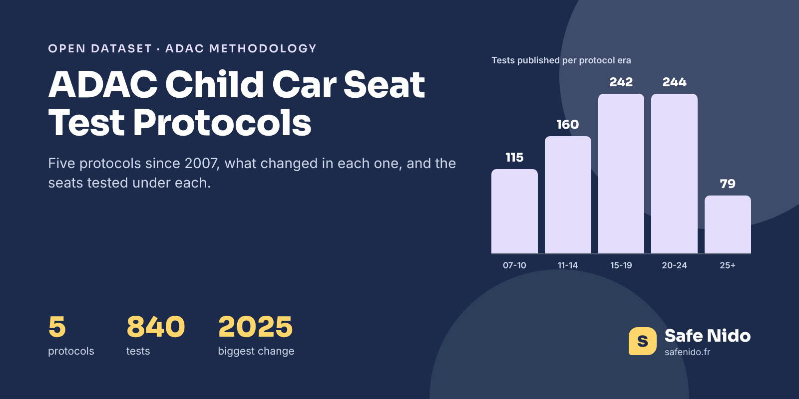

# ADAC Child Car Seat Test Protocols 2007-2026



[](https://doi.org/10.5281/zenodo.24167377) [](https://www.kaggle.com/datasets/safenido/adac-child-car-seat-test-protocols-2007-2026) [](https://huggingface.co/datasets/safenido/adac-child-seat-test-protocols) [](https://creativecommons.org/licenses/by/4.0/) [](https://www.safenido.fr/)

**English first, version française plus bas.**

An ADAC grade from 2012 and one from 2026 do not mean the same thing. ADAC changed its child seat test four times, in 2011, 2015, 2020 and 2025, with a new car body, new dummies, new crash speeds or a new weighting. This small reference table lists **the five protocols, what each one changed, and how many seats were tested and failed under each**, so that grades can be compared fairly.

### The Headline Numbers

|  |  |
|---|---|
| Protocols | 5 |
| Tests, 2007-2010 | 115 |
| Tests, 2011-2014 | 160 |
| Tests, 2015-2019 | 242 |
| Tests, 2020-2024 | 244 |
| Tests since 2025 | 79 |

The 2025 protocol is the biggest change so far, with a Kia Sportage body, a harder front impact, a side impact at 60 km/h and PFAS in the lab tests. That is why average grades rose in 2025 and 2026 without seats getting worse, and why Safe Nido always shows the date of a test next to its grade.

### Files

| file | content |
|---|---|
| `data/adac_child_seat_test_protocols.csv` | 5 rows, one per protocol era |
| `images/cover.png` | Cover image, 1600 × 800 |

### Columns

**adac_child_seat_test_protocols.csv**

| column | description |
|---|---|
| `protocol_era` | Era |
| `first_year` | First year of the era |
| `vehicle_body` | Car body used for the crash tests |
| `front_impact` | Front impact change, when stated |
| `side_impact` | Side impact change, when stated |
| `weighting` | Weighting of the parts of the grade, when stated |
| `harmful_substances` | Substance testing |
| `pfas` | PFAS testing |
| `tests` | Tests published in the era |
| `mean_overall_grade` | Average overall grade |
| `share_poor_pct` | Share of seats rated poor |
| `summary_fr` | Summary in French |
| `safenido_url` | Explanation on Safe Nido |

### Load It

```python
import pandas as pd

base = "https://raw.githubusercontent.com/safenido/adac-child-seat-test-protocols/main"
df = pd.read_csv(f"{base}/data/adac_child_seat_test_protocols.csv")
df[["protocol_era", "vehicle_body", "tests", "share_poor_pct"]]
```

### How It Was Built

Protocol changes were summarised from ADAC's methodology publications by Safe Nido. Empty cells mean the change was not documented for that era. Counts and averages come from the Safe Nido database of published results.

### Checked Against The Source

The test counts add up to the 840 tests of the companion datasets.

### Read With Care

- **A summary, not the full methodology.** ADAC publishes the detailed protocol.
- **Some details are not documented for every era** and are left empty rather than guessed.

### License And Citation

**[CC BY 4.0](https://creativecommons.org/licenses/by/4.0/)**. Use it, share it and adapt it, commercially or not, and credit **Safe Nido** with a link to **[safenido.fr](https://www.safenido.fr/)**, along with the original source below.

```bibtex
@misc{safenido_adac_child_seat_test_protocols_2026,
  title  = {ADAC Child Car Seat Test Protocols 2007-2026},
  author = {{Safe Nido}},
  year   = {2026},
  doi    = {10.5281/zenodo.24167377},
  url    = {https://github.com/safenido/adac-child-seat-test-protocols},
  note   = {Dataset, version 1.0}
}
```

Source. ADAC test methodology, summarised by Safe Nido, with statistics from the published results, https://www.safenido.fr/crash-test-siege-auto/lire-une-note-adac/

Archived on **[Zenodo](https://doi.org/10.5281/zenodo.24167377)** with a permanent DOI, 10.5281/zenodo.24167377.

Companion datasets, **[ADAC Child Car Seat Test Sessions 2007-2026](https://github.com/safenido/adac-child-seat-test-sessions)** ([Kaggle](https://www.kaggle.com/datasets/safenido/adac-child-car-seat-test-sessions-2007-2026), [Hugging Face](https://huggingface.co/datasets/safenido/adac-child-seat-test-sessions)), **[ADAC Child Car Seat Test Criteria Statistics](https://github.com/safenido/adac-child-seat-criteria-statistics)** ([Kaggle](https://www.kaggle.com/datasets/safenido/adac-child-car-seat-test-criteria-statistics), [Hugging Face](https://huggingface.co/datasets/safenido/adac-child-seat-criteria-statistics)). All Safe Nido datasets are listed in **[Child Passenger Safety Datasets](https://github.com/safenido/child-passenger-safety-datasets)**.

Also on **[GitHub](https://github.com/safenido/adac-child-seat-test-protocols)**, **[Kaggle](https://www.kaggle.com/datasets/safenido/adac-child-car-seat-test-protocols-2007-2026)** with a starter notebook, and **[Hugging Face](https://huggingface.co/datasets/safenido/adac-child-seat-test-protocols)**, ready for the `datasets` library.

### On Safe Nido

The data behind these files is used on [Safe Nido](https://www.safenido.fr/), an independent French guide to child car seats built on twenty years of crash tests.

- [How to read an ADAC grade](https://www.safenido.fr/crash-test-siege-auto/lire-une-note-adac/)
- [Our method](https://www.safenido.fr/methode/)
- [Every ADAC session](https://www.safenido.fr/test-adac/)

---

## Version Française

### Les Protocoles Des Tests ADAC Depuis 2007

Les cinq protocoles de test des sièges auto de l'ADAC depuis 2007, ce que chacun a changé (carrosserie, mannequins, vitesses, pondération, substances, PFAS) et le nombre de sièges testés et recalés sous chacun. Indispensable pour comparer deux notes de dates différentes.

Licence CC BY 4.0, en citant **Safe Nido** et un lien vers **[safenido.fr](https://www.safenido.fr/)**. Retrouvez les guides et les fiches des sièges sur [Safe Nido](https://www.safenido.fr/).
